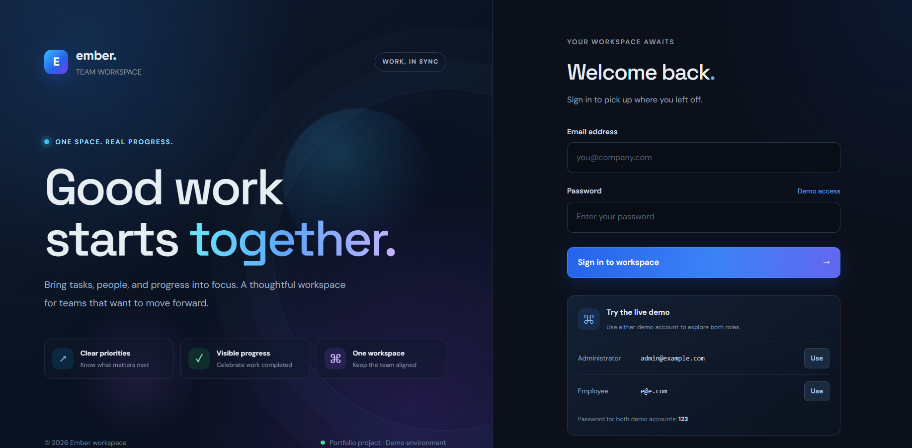
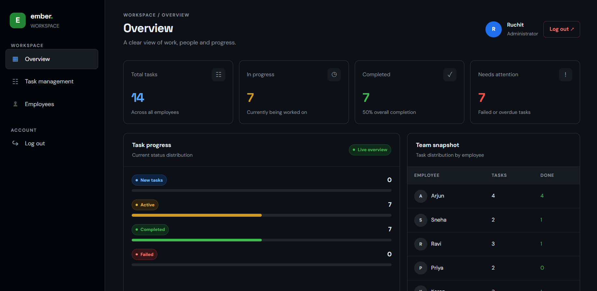
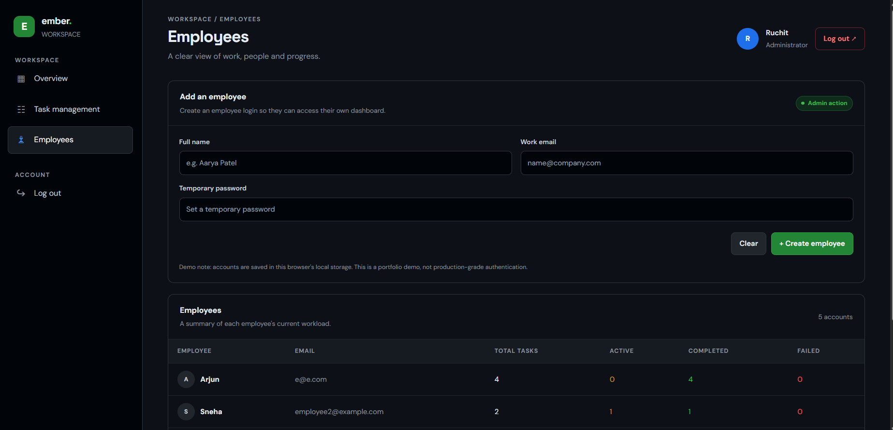
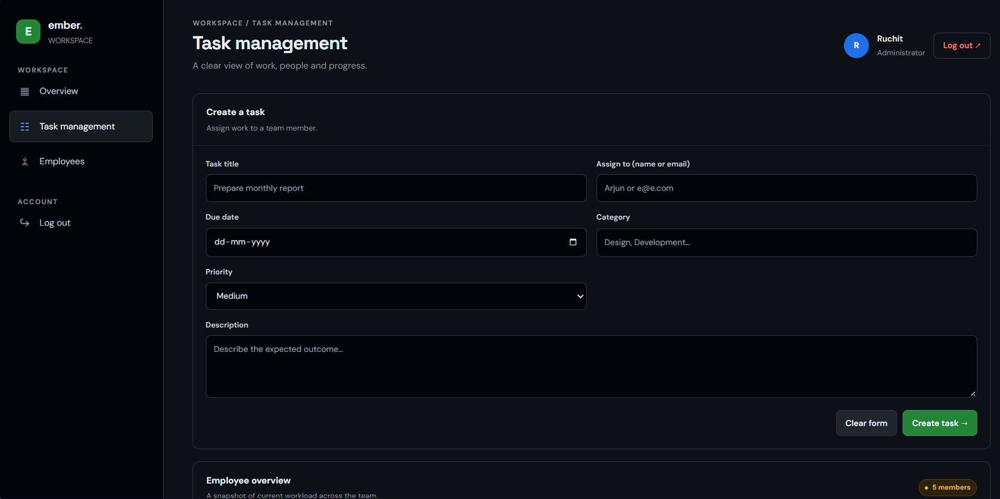
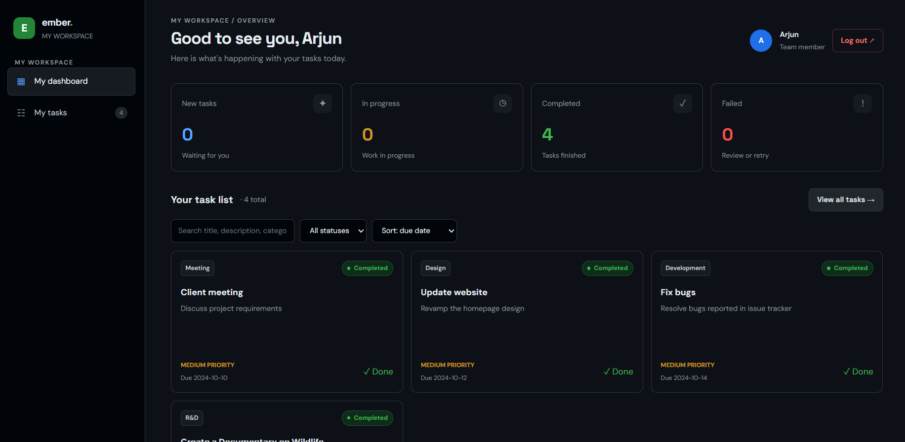

# Employee Management System (EMS)

A modern employee and task management application built with React. EMS provides separate admin and employee dashboards for managing employees, assigning tasks, and tracking task progress through a dark, GitHub-inspired interface.

## 📸 Screenshots

### Login Page


### Admin Dashboard


### Employee Management


### Task Management


### Employee Dashboard


> **Note:** Replace these images with your own screenshots. Keep the filenames consistent with the files in your `screenshots/` folder.

## 🎬 Project Demo

Watch the application demo to see the login flow, employee management, task assignment, and task status updates.

**[▶ Watch the EMS Demo on YouTube](YOUR_YOUTUBE_VIDEO_URL)**

Alternatively, you can add a GIF preview directly to this README:


## ✨ Features

### Admin
- Admin dashboard with task statistics
- Create and manage employee accounts
- Create, assign, edit, and delete tasks
- Update task details, including title, description, due date, priority, category, and status
- Search, filter, and sort tasks
- Track employee task progress

### Employee
- Dedicated employee dashboard
- View assigned tasks
- Search, filter, and sort tasks
- Accept new tasks
- Mark tasks as completed or failed
- Retry failed tasks

### UI/UX
- Dark, GitHub-inspired design
- Responsive dashboard layout
- Task status indicators and metrics
- Form validation and feedback
- Browser local storage for demo data persistence

## 🛠️ Tech Stack

- **Frontend:** React, JavaScript
- **Styling:** Tailwind CSS and custom CSS
- **Build Tool:** Vite
- **Storage:** Browser local storage

## 🚀 Getting Started

### Prerequisites

- Node.js and npm installed
- Git installed (optional, for cloning the repository)

### Installation

1. Clone the repository:

   ```bash
   git clone https://github.com/YOUR_USERNAME/employee-management-system.git
   ```

2. Navigate to the project directory:

   ```bash
   cd employee-management-system
   ```

3. Install dependencies:

   ```bash
   npm install
   ```

4. Start the development server:

   ```bash
   npm run dev
   ```

5. Open the local URL displayed in your terminal.

## 🔐 Demo Credentials

**Admin**
- Email: `admin@example.com`
- Password: `123`

**Employee**
- Email: `e@e.com`
- Password: `123`

These credentials are for the local demonstration only. Do not use real passwords or sensitive personal information.

## 🗺️ Future Improvements

- Backend API using Node.js and Express
- MongoDB database integration
- Secure authentication and server-side role-based authorization
- Automated testing
- Deployment with a live demo

## ⚠️ Limitations

This version uses browser local storage for demo data and client-side authentication. It is intended as a learning project and is not production-ready. Data is browser-specific, and authentication does not provide production-level security.

## 👨‍💻 Author

**Ruchit Rathod**

- GitHub: [RuchitRathod](https://github.com/RuchitRathod)
- LinkedIn: [Connect with me](https://www.linkedin.com/in/ruchit-rathod-521266284/)

---

⭐ If you find this project interesting, consider starring the repository.
